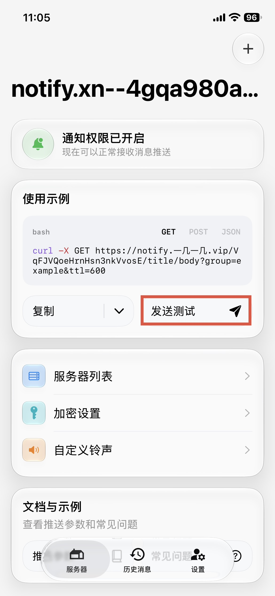
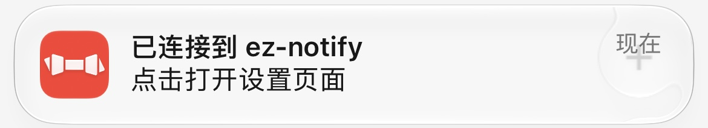
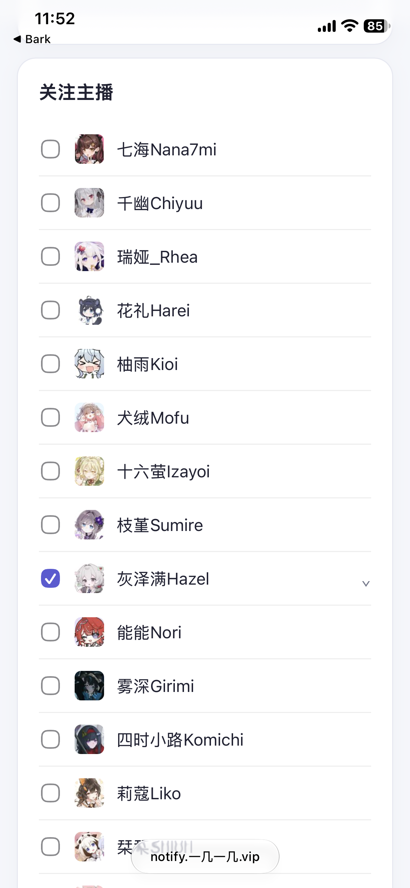
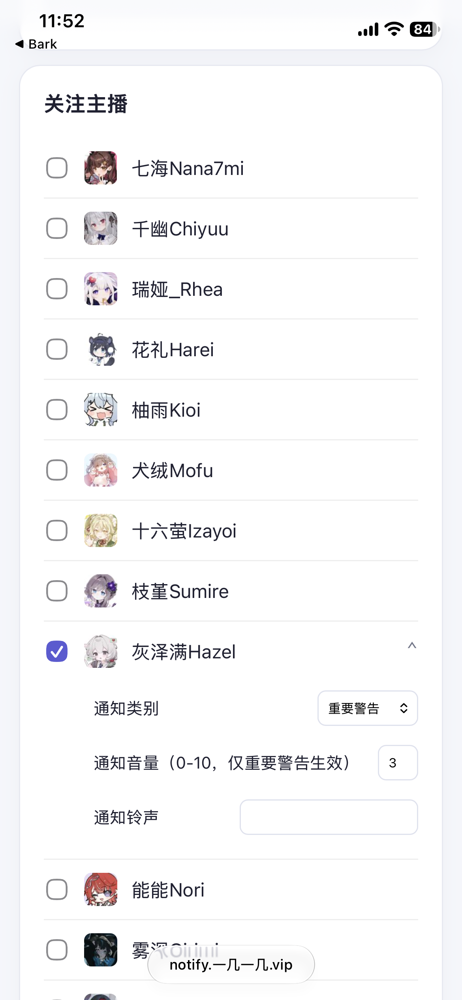

# EZ Notify

监测直播间开播状态并进行统一推送的服务。

## Bark (iOS)

1. 在 iOS 上安装 Bark，并允许`重要提醒`通知权限。

    <a target='_blank' href='https://apps.apple.com/cn/app/bark-custom-notifications/id1403753865' style='margin: 15px;'>
    <picture>
      <source media='(prefers-color-scheme: dark)' srcset='/icons/app_store/Download_on_the_App_Store_Badge_CNSC_RGB_wht_092917.svg' />
      
    </picture>
    </a>

2. 将服务器添加到 Bark

    [添加服务器](bark://addServer?address=https%3A%2F%2Fnotify.xn--4gqa980aba.vip)

    或手动添加
    - `https://notify.xn--4gqa980aba.vip`

    注意不要泄露 Bark 中的 `Key`，若意外泄露请及时重置。

3. 在 Bark 主界面点击发送测试，收到通知即代表添加成功。

**有时候设备会从APNS服务断开，表现为出现激活界面、iMessage断开等，此时Device Token可能重置，请手动打开Bark重新注册（Bark会自动完成）并测试是否能收到消息。**

### 通知配置

点击上一步收到的通知，进入设置页面。

勾选主播订阅对应的开播通知

点击页面底部按钮保存

#### 自定义通知类型

订阅开播通知后可以展开详细设置，可以配置4中通知类别

- 默认：系统会立即亮屏显示通知
- 时效性通知：专注模式下也能显示
- 静音：仅将通知添加到通知列表，不会亮屏提醒
- 重要警告：静音模式下也会响铃，持续循环30s

重要警告可以配置通知音量

#### 自定义铃声

在`Bark-自定义铃声`中上传自定义铃声

将自定义铃声名粘贴到`通知铃声`中

## WebPush (Microsoft Edge/Google Chrome/Firefox/Safari)

[点击跳转EZ Notify](https://notify.xn--4gqa980aba.vip)

根据页面提示获取通知权限

iOS 需要系统版本高于 16.4 且将页面添加到主屏幕

WebPush 仅能发送普通通知，打开网页版b站

WebPush 推送服务由浏览器提供，不同浏览器可能存在延迟或无法推送

浏览器兼容性详见[MDN](https://developer.mozilla.org/zh-CN/docs/Web/API/Push_API#%E6%B5%8F%E8%A7%88%E5%99%A8%E5%85%BC%E5%AE%B9%E6%80%A7)

## 如何选择 EZ Notify 与 直播推送（旧）

### 选择 EZ Notify

- 需要关注多个主播
- 需要关注到主播的每一次开播，但接受服务维护等特殊情况时若遗漏开播通知则整场直播都不会收到补发
- 需要更快地收到通知
- 可以接受主播调整时多次上下播会重复通知
- 需要在PC等其它设备上收到通知
- 需要重要提醒以外的通知方式

### 选择直播推送（旧）

- 只关注灰发小女孩
- 可以开播后稍晚一点收到通知
- 可以接受最大 5min 内回马播可能不会收到通知
- 只需要默认铃声的 30s 重要提醒，不需要自定义通知
